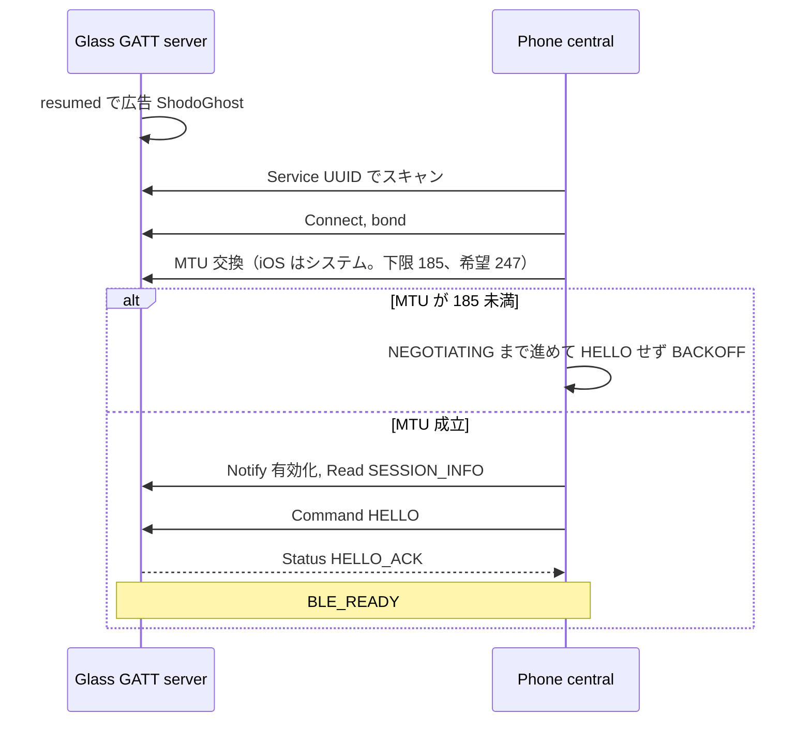
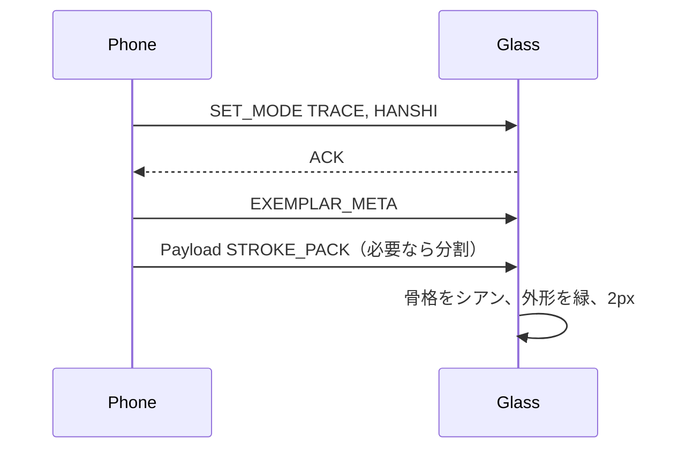
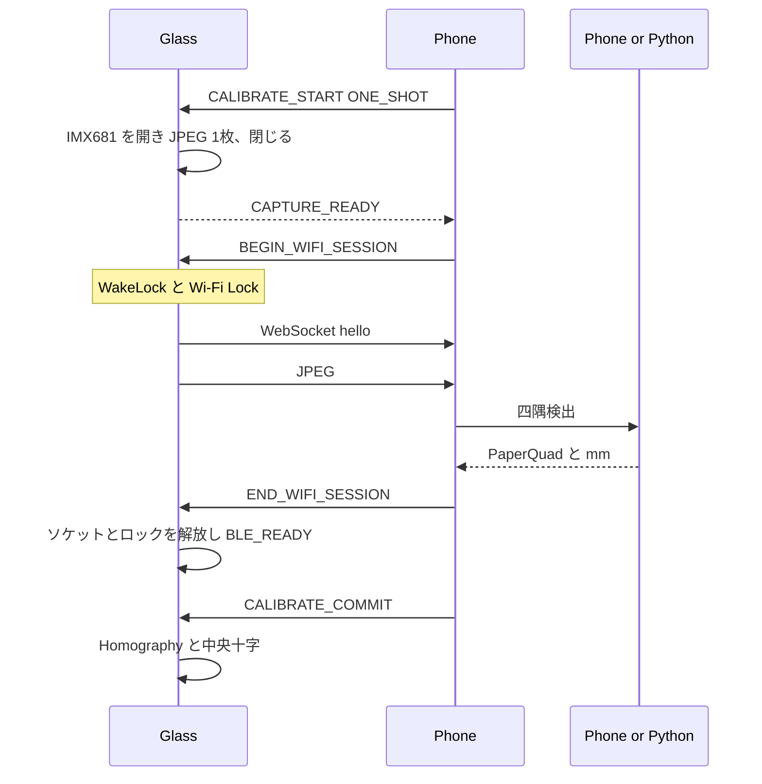
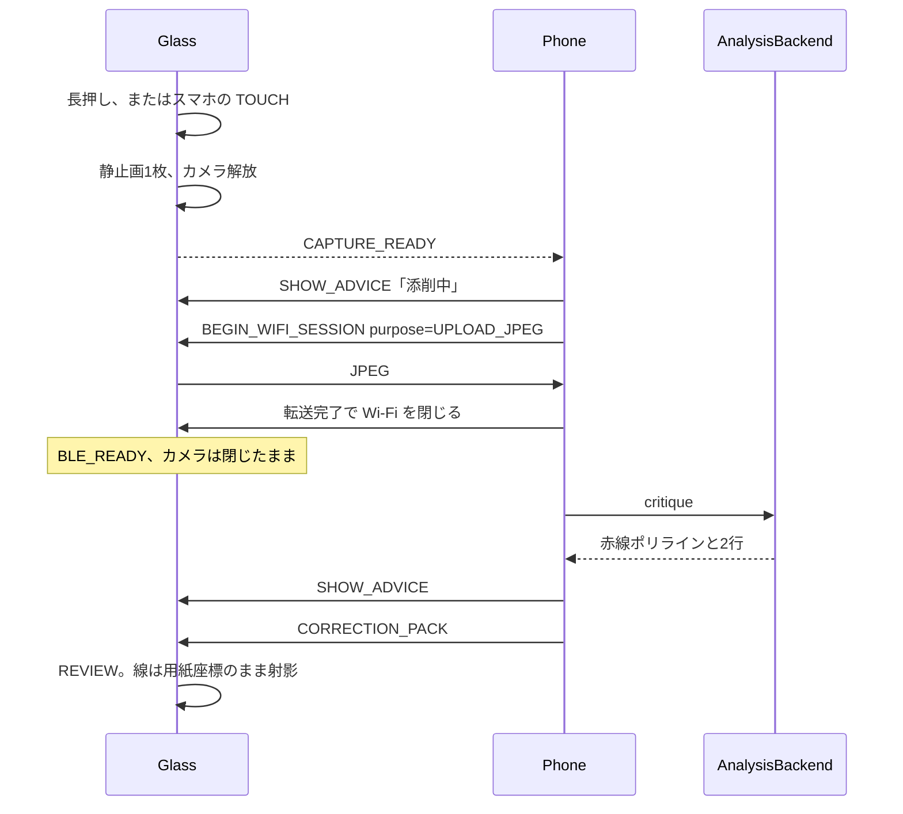
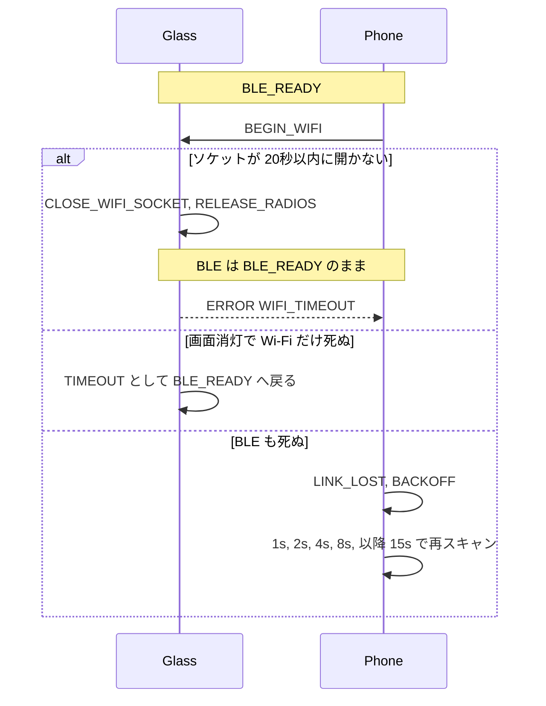
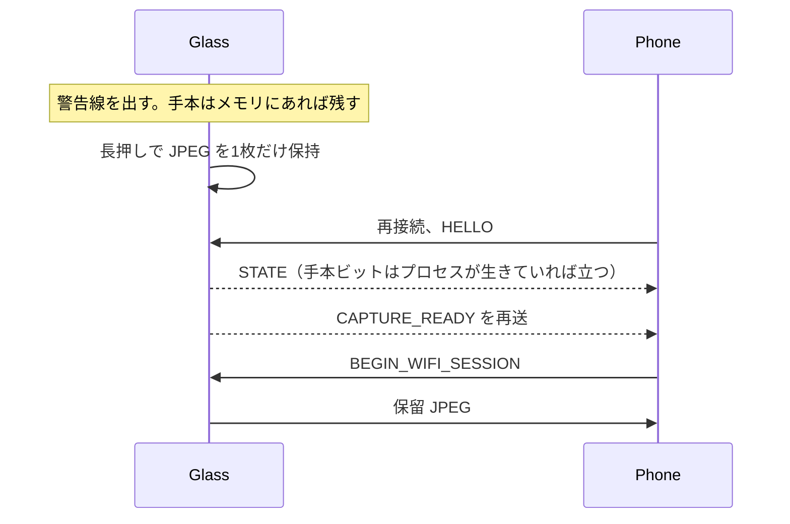

# 通信シーケンス

状態名は `LinkPhase`。副作用の順は `LinkStateMachine.step` の `effects`。

## リンク

`HELLO_ACK.accept` が 0 のときは `HELLO_REJECTED` で `BACKOFF`。

`END_WIFI_SESSION` の ACK が OK のとき、`WIFI_WAKE` からは `STOP`、`TRANSFER` からは `TRANSFER_FINISHED` で `WIFI_TEARDOWN` に入り、続けて `WIFI_TORN_DOWN` で `BLE_READY` に戻る。`WIFI_CLOSED` が後から来ても、すでに `BLE_READY` なら相は動かない。セッション実装は [phase-2.md](phase-2.md)。

## 手本を載せる

## 四隅キャリブレーション

SLAM 方式（`CalibMethod.SLAM`）はこの図に出さない。アダプタが無いビルドは `UNSUPPORTED_MODE` を返す。

## 書き終わりと添削

Wi-Fi はアップロードだけに使う。VLM の待ち時間は BLE に戻してから過ごす。

`AnalysisBackend` が LAN の Python を呼ぶ場合、その WebSocket はスマホと PC のあいだで、グラスは関与しない。

## スリープと Wi-Fi の失敗

画面消灯でアプリプロセスが生きていれば BLE は維持してよい。広告が止まれば iPhone からは `LINK_LOST` に見える。

iPhone の待受は練習画面が前面のときだけ開く。背面やロック中に `BEGIN_WIFI` は送らない。`CAPTURE_READY` が背面で届いたらアプリはそれを覚え、前面に戻ってからバーストを始める。詳細は [iphone.md](iphone.md)。

## 未接続で書いたとき

プロセスが死んでいれば手本ビットは落ちる。スマホがパックを送り直す。保留 JPEG も消える。Phase 5 で、ディスクへの保存はしないと決めた。生きているプロセスのメモリ 1 枚まで。手順は [phase-5.md](phase-5.md)。
